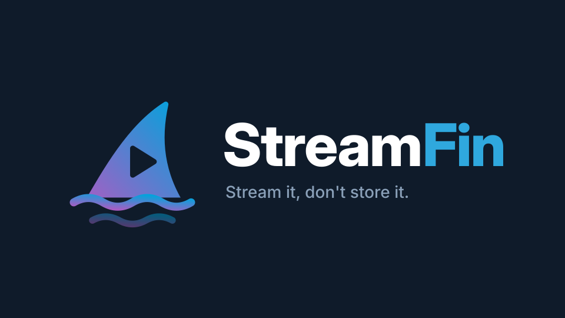

<p align="center"></p>

<p align="center">
  <a href="https://github.com/mmrmagno/jellyfin-plugin-streamfin/releases/latest"></a>
  <a href="#install"></a>
  <a href="https://github.com/mmrmagno/jellyfin-plugin-streamfin/actions/workflows/compat.yml"></a>
  <br>
  <a href="https://github.com/mmrmagno/jellyfin-plugin-streamfin/actions/workflows/build.yml"></a>
  <a href="https://github.com/mmrmagno/jellyfin-plugin-streamfin/actions/workflows/security.yml"></a>
  <a href="https://scorecard.dev/viewer/?uri=github.com/mmrmagno/jellyfin-plugin-streamfin"></a>
  <a href="LICENSE"></a>
</p>

**StreamFin** streams anime, movies, TV and lossless music into Jellyfin. Nothing is downloaded.
Press play and it starts in Jellyfin's own player, with progress, resume and subtitles.

It adds three channels: **Anime**, **Movies & TV** and **Music**.

## Why

My server does not have room for everything I might watch, and most of it I watch once.
StreamFin finds the stream when I press play, so the disk only holds what I keep.
It works on TV apps too. It started as AniFin (anime only) and grew into StreamFin.

## Features

**Anime**
- Popular, This Season and A to Z, from AniList.
- Japanese audio with English subtitles. Never a dub.
- The next episode is prepared while one plays, so Next episode starts at once.
- If a source fails, the same episode plays from another source, but only when that source lists exactly this title.
- Titles show their AniList score, genres, animation studio, main tags and wide banner art.

**Movies & TV**
- Popular movies, popular TV and trending, from TMDB.
- Shows open into seasons and episodes. The next episode is prepared while one plays.
- Titles show their TMDB rating, genres, age rating, studio or network, cast and director with photos, backdrop and
  logo, and link to IMDb.
- Seven video sources are asked at once. The best answer plays (up to 4K, H.264 first so most devices need no
  conversion), and the others appear as versions in the player, named by source, quality and codec.
  A quality setting can cap it at 1080p or 720p.

**Music**
- Lossless FLAC from Monochrome's catalog: CD quality, and 24 bit on some albums. Never transcoded.
- Popular songs, albums and artists from Deezer's charts. Artist, album and song search.
- Albums open with numbered tracks. Artists show their top tracks, albums and singles.
- Starred, Recently played and Playlists folders. Lyrics from [LRCLIB](https://lrclib.net), synced where they exist.
- **Your year in music**: your most played songs, artists and albums of each year, with minutes and play counts.
  Subsonic apps get the top songs as a playlist. Plays are counted from the moment you install this version.
- Played songs are kept on the server (4 GB by default) so replays and skips are instant.
- Instant Mix and radio from [ListenBrainz](https://listenbrainz.org). A Last.fm key is optional.
- Starred albums can be saved to a music library folder as tagged FLAC files.
- If the catalog is down, what it has already answered keeps working, and Deezer covers searches, albums and artists.
- YouTube can fill in songs the catalog cannot send. It is off by default, and its songs play as AAC, which the song details say.

**Search and access**
- Jellyfin's search also finds online titles, tagged *Streamable*. A switch turns this off.
- A search started on a catalog page searches only that catalog.
- Only the users you tick see the channels.

**Layout**
- **Show in Jellyfin** picks the layout: the three separate channels (the default), one **StreamFin** entry with
  Anime, Movies & TV and Music inside, or both. Watch progress and favourites are the same in every layout.
- A StreamFin entry can also sit at the top of any of your libraries, leading to anime, popular movies, popular TV
  or music. The library's own files are not touched.

## Sources

| Source | Used for | Finds the show by | Subtitles |
|---|---|---|---|
| HiAnime | Anime | MyAnimeList ID | Separate English track |
| AnimeGG | Anime | Title search | Burned in |
| AnimeHeaven | Anime | Title search | Burned in |
| FlixHQ | Movies and TV | Title and year | Usually a separate English track |
| Astra | Movies and TV | TMDB ID | Separate English tracks |
| Vidly | Movies and TV | TMDB ID | Separate English tracks |
| VidBolt | Movies and TV | TMDB ID | Separate English tracks |
| VidRift | Movies and TV, up to 4K | TMDB ID | Separate English tracks |
| Rive | Movies and TV, English audio, up to 720p | TMDB ID | Separate English tracks |
| Punkflix | Mostly movies | TMDB ID | Separate English tracks |
| Monochrome | Music (FLAC) | Its own IDs, with ISRCs | Not applicable |
| Deezer | Music catalog, when Monochrome cannot answer | Its own IDs, with ISRCs | Not applicable |
| YouTube | Music, off by default | Artist and title, same length within 3 s | Not applicable |

The settings show each source's state, and the anime, movie and music sources have a **Test now**
button. A source that keeps failing is skipped and checked again in the background.

## Install

Needs Jellyfin **12.3** or newer.

1. In Jellyfin, open **Dashboard > Plugins > Repositories** and add:
   ```
   https://github.com/mmrmagno/jellyfin-plugin-streamfin/releases/latest/download/manifest.json
   ```
2. Install **StreamFin** from the catalog (under Channels), then restart Jellyfin.
3. Open **Dashboard > Plugins > StreamFin**, turn it on, and tick the users who may use it.
   Nobody is ticked by default.
4. For Movies & TV, create a free account at themoviedb.org, open **Settings > API**, and paste the key.
   Both the short key and the read access token work.

Music needs no key. If a channel is missing, check that your user is ticked and the TMDB key
is saved, then reload the app.

To give the channels their own icons in the web app, create an API key under
**Dashboard > API Keys** and run, from a clone of this repo:

```sh
JELLYFIN_TOKEN=<key> python3 scripts/web-icon.py --url https://your.jellyfin --channel Anime
JELLYFIN_TOKEN=<key> python3 scripts/web-icon.py --url https://your.jellyfin --channel "Movies & TV"
JELLYFIN_TOKEN=<key> python3 scripts/web-icon.py --url https://your.jellyfin --channel Music
```

## Music apps (Subsonic)

StreamFin also speaks OpenSubsonic, so apps like Symfonium, Feishin, Tempo or play:Sub work,
with gapless playback, queues, offline downloads and synced lyrics.

1. In the settings, under **Subsonic apps**, turn the API on and press **New password** for a user.
2. In the app, choose Subsonic or OpenSubsonic and enter:
   - **Server**: `https://your.jellyfin/StreamFin`
   - **Username**: your Jellyfin username
   - **Password**: the app password from the settings, not your Jellyfin password

Apps send their credentials in every request address, as Jellyfin's own apps send tokens.
Keep proxy and server logs private. If a password may have leaked, press **New password** to revoke it.

## Catalog cache

The **Cache** section of the settings shows how many answers are kept and has two buttons:
**Clear catalog cache** empties the caches and makes Jellyfin rebuild its listings, and
**Warm catalog cache** loads the first pages of Anime and Movies & TV now. Warming also runs
at startup and every six hours.

## How it works

- Titles, posters and episode lists come from AniList, TMDB, Monochrome and Deezer.
  Sources only turn an episode into a video address.
- Jellyfin never sees the site's address. It gets a local address with a one-off ticket,
  and the plugin fetches the video itself.
- Music is served as the catalog's FLAC, byte for byte, with seeking.
- Pages you opened before show at once. Once they are old, a fresh copy loads in the background.
- Nothing from the sites is run. The one exception is yt-dlp, which runs YouTube's player code
  with deno when the YouTube fallback is on. Both are downloaded from their official releases and
  checked against the published SHA-256 before use.

## Building

Needs Docker, Python 3 and Bash. No local .NET install.

```sh
bash scripts/fetch-references.sh
bash scripts/build.sh
```

This runs the tests and writes the plugin zip to `artifacts/`. CI runs the same build on every push,
plus CodeQL, a secret scan and a workflow lint. Every Monday it also loads the plugin on the newest
Jellyfin. Everything that parses a third-party page is fuzzed.

## Credits

- The AnimeGG and AnimeHeaven adapters are adapted from the MIT-licensed
  [Seanime providers](https://github.com/Seanime-contributions/Seanime-Providers).
- The HiAnime flow follows [ani-cli](https://github.com/pystardust/ani-cli), written from scratch.
- FlixHQ is a port of my own downloader.
- The anime source fallback, the queue fix, the Popular music folders, the StreamFin entry and the library links come from
  [ItzDabbzz's fork](https://github.com/ItzDabbzz/jellyfin-plugin-streamfin) (GPL-2.0).
- Icons are from Material Design Icons. Third-party details are in `THIRD_PARTY_NOTICES.txt`.

StreamFin hosts nothing. It plays what third-party sites already serve. Whether that is legal
where you live is up to you.

I write about my projects at [marc-os.com](https://marc-os.com).

## License

[GPL-2.0](LICENSE).
